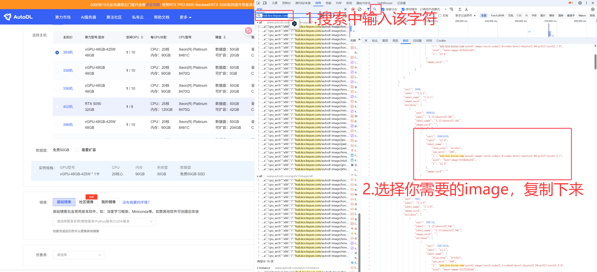

# AutoDL GPU 自动监控工具

> 🚀 一个智能的 AutoDL 平台 GPU 资源监控和自动购买工具

本项目专为 AutoDL 平台设计，能够自动监控空闲 GPU 资源，并在满足条件时自动购买启动实例。特别适用于需要抢占稀缺 GPU 资源的深度学习任务场景。

## ✨ 核心功能

- 🔍 **智能监控**: 实时监控指定型号的 GPU 可用性
- ⚡ **自动购买**: 发现可用资源时自动下单购买
- 📱 **即时通知**: 可开关的本地系统通知
- 🎯 **精准配置**: 支持多种 GPU 型号、数量和镜像配置
- 🔐 **安全登录**: 支持手机号密码登录和微信扫码登录
- 🎮 **双模式运行**: 监控模式 vs 监控+购买模式

## 🚀 快速开始

### 环境准备

确保你的系统已安装 Python 3.8+

```bash
# 创建虚拟环境
python -m venv venv

# 激活虚拟环境
# Linux/macOS
source venv/bin/activate
# Windows
venv\Scripts\activate

# 安装依赖包
pip install -r requirements.txt
```

### 快速运行
   ```bash
   python main.py
   ```

## ⚙️ 配置详解

普通参数放在 `config.json`，授权令牌推荐单独放在同目录的 `.env`：

```bash
cp .env.example .env
```

编辑 `.env`，填写 `API_TOKEN=你的授权令牌`。`.env` 已被 Git 忽略，可以提交 `config.json` 和 `.env.example`，不要提交真实令牌。

`config.json` 中使用 `"authorization": "${API_TOKEN}"`（必须有双引号）。也兼容原来的 `"authorization": "你的授权令牌"` 写法，但不要提交包含真实令牌的 JSON。读取优先级为系统环境变量、`.env`、JSON 明文；占位符未找到时视为未配置。更新令牌的方法只写入 `.env`。

以下是完整的配置说明：

### 📋 配置模板

```json
{
  "authorization": "${API_TOKEN}",
  "account_type": "sub_user",
  "mode": "monitor_and_buy",
  "gpu": {
    "model": ["RTX 4090", "RTX 5090"],
    "num": 1
  },
  "image": {
    "private_image_uuid": "",
    "autodl_image": "hub.kce.ksyun.com/autodl-image/torch:cuda12.4-cudnn-devel-ubuntu22.04-py312-torch2.5.1"
  },
  "notification": {
    "enabled": true
  }
}
```

### 🔧 参数详解

#### 🔑 authorization
- **功能**: AutoDL 平台授权令牌，用于 API 认证
- **类型**: `string`
- **获取**: 使用你的 AutoDL 授权令牌，推荐填写到 `.env` 的 `API_TOKEN`
- **说明**: 支持 `${API_TOKEN}` 占位符和原来的明文形式。当前工作区缺少 `login_helper.py`，自动登录暂不可用，需要恢复该模块才能运行 `main.py`。

#### 👤 account_type
- `"sub_user"`：子账号（默认，兼容未配置该字段的旧配置）。
- `"public"`：公开账号，使用源项目的普通账号接口。
- 同时切换 GPU 监控、机器列表和创建实例接口；令牌必须属于所选账号类型，切换时请同步更新 `.env` 中的 `API_TOKEN`。
- 建议切换后先使用 `monitor_only` 验证授权，再开启购买。

#### 🎮 mode
- **功能**: 程序运行模式
- **类型**: `string`
- **选项**: 
  - `"monitor_only"` - 👀 仅监控模式（发现资源时通知但不购买）
  - `"monitor_and_buy"` - 💰 监控购买模式（发现资源时自动购买）
- **默认**: `"monitor_only"`
- **推荐**: 测试时使用 `monitor_only`，确认无误后切换到 `monitor_and_buy`

#### 3. gpu 对象
##### 3.1 model
- **说明**: 要监控和购买的 GPU 型号，支持同时监控多个型号
- **类型**: 字符串或非空字符串列表，兼容原来的单型号配置
- **多型号示例**: `"model": ["RTX 4090", "RTX 5090", "RTX 3090"]`
- **运行行为**: 每轮依次查询所有型号；仅监控模式汇总可用型号通知后退出。购买模式按列表顺序尝试，成功购买一个实例后退出，不会每个型号都购买。`num` 是单个实例的卡数，不是型号数；仅监控模式有空闲卡即通知，不按 `num` 筛选。
- **可选值**: 完整型号列表见 `gpu_catalog.json` 的 `models`，使用官网原始名称（例如 `RTX PRO 6000`、`RTX 5090 D`，注意空格）。
- **新增型号**: `RTX PRO 6000`、`A800-80GB-NVLink`、`RTX 6000D`、`PRO 6000 Max-Q`、`RTX PRO 5000`、`RTX 5090 D`、`MTT S4000`、`vGPU-48GB-425W`、`vGPU-48GB-350W`。
- **更名兼容**: `RTX 3080*2` → `RTX 3080x2`；`RTX 2080 Ti *2` → `RTX 2080 Ti x2`。
- **区域来源**: 官网只读接口 [型号列表](https://www.autodl.com/api/v1/machine/gpu_type) 和 [区域列表](https://www.autodl.com/api/v1/region/list)。按官网数据中心分组，仅查询公开区域，包含新增的 `west-D/E`、`bj-B2/B3`、`sh-A1`。
- **重要**: `gpu2region` 现在表示每个型号的查询候选区域，不代表所有区域实际部署了该型号；实际分布及空闲数量由登录后的 `machine/region/gpu_type` 接口确认。没有返回某型号不等于永久下线。原表中不在当前官网型号目录中的名称不再接受。
- **刷新目录**: 运行 `python update_gpu_catalog.py`，成功后重启监控。刷新失败会保留原文件。官网快照为 33 个型号、10 个公开区域组；上游变化后数量可能变化。
- **性能说明**: 为避免旧映射漏卡，每个型号查询所有公开区域组，因此多型号时请求数比原来多。

##### num - GPU 数量
- **功能**: 指定购买的 GPU 卡数
- **类型**: `integer`
- **范围**: 1-8（根据 GPU 型号限制）
- **示例**: `1` (单卡), `4` (四卡并行)

#### 🐳 镜像配置

##### private_image_uuid - 私有镜像
- **功能**: 使用自定义私有镜像
- **类型**: `string`
- **获取**: AutoDL 控制台 → 镜像管理 → 查看镜像 UUID
- **示例**: `"image-4933eddca6"`
- **说明**: 优先使用私有镜像，为空则使用公共镜像

##### autodl_image - 公共镜像
- **功能**: 指定 AutoDL 官方镜像
- **类型**: `string`

**🔥 推荐镜像**:
| 框架版本 | 镜像地址 | 适用场景 |
|----------|----------|----------|
| PyTorch 2.5.1 | `hub.kce.ksyun.com/autodl-image/torch:cuda12.4-cudnn-devel-ubuntu22.04-py312-torch2.5.1` | 最新版本 |
| PyTorch 2.3.0 | `hub.kce.ksyun.com/autodl-image/torch:cuda12.1-cudnn-devel-ubuntu22.04-py312-torch2.3.0` | 稳定版本 |
| PyTorch 2.1.2 | `hub.kce.ksyun.com/autodl-image/torch:cuda11.8-cudnn8-devel-ubuntu22.04-py310-torch2.1.2` | 兼容性好 |

**📸 镜像选择指南**:

<details>
<summary>🖼️ 如何选择公共镜像</summary>



1. 进入 AutoDL 控制台
2. 选择"创建实例"
3. 在镜像选择中找到对应版本
4. 复制镜像地址到配置文件

</details>

<details>
<summary>🔒 如何使用私有镜像</summary>


1. 进入 AutoDL 控制台
2. 点击"我的镜像"
3. 找到目标镜像的 UUID
4. 复制到 `private_image_uuid` 字段

</details>

#### 📱 通知配置

购买成功后会在运行程序的电脑上显示型号、卡数和机器 ID。Linux 使用系统通知，不依赖 Tkinter（Ubuntu/Debian 可安装 `sudo apt install libnotify-bin`），需要已登录的桌面会话和可用的通知服务；其他系统仍使用 Tkinter 弹窗。提示独立运行，不阻塞抢卡程序退出。SSH/无桌面服务器不会通知你的本地电脑。

##### enabled - 系统通知开关
- `true`：启用通知（默认）。
- `false`：关闭通知，仅保留终端输出。
- 修改 `config.json` 中的 `notification.enabled` 后重启程序生效。
- 适用于仅监控模式的资源可用通知和购买模式的成功通知；关闭通知不影响购买和退出逻辑。

本项目部分代码参考了 [autodl-gpu-monitor](https://github.com/Jiayi-Fu/autodl-gpu-monitor) 项目，感谢原作者的贡献。

---

<div align="center">

